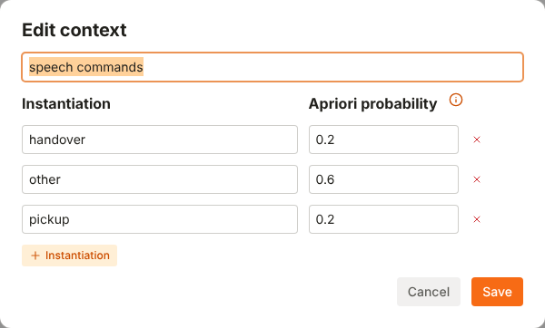
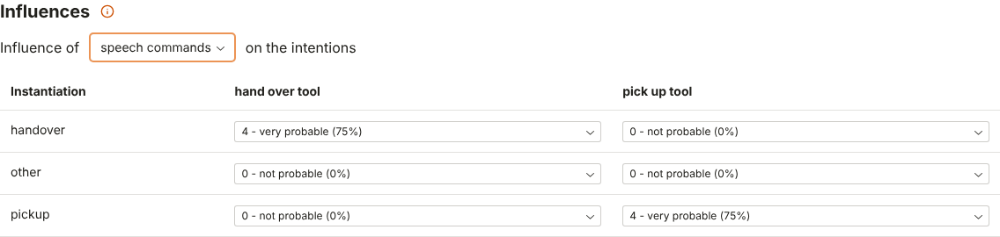
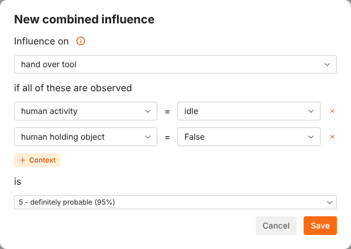
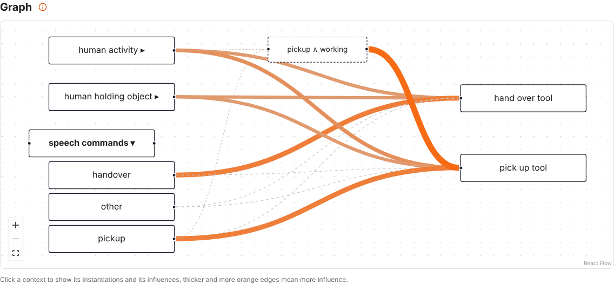

## Purpose of CoBaIR
The CoBaIR framework is designed to interpret human intentions within diverse settings, assigning probabilities to these intentions based on the contextual information provided in multimodal scenarios.

## Prerequisites
Before starting to design a scenario with CoBaIR you need to understand some basics.

### Intentions
Intentions denote what a human in an HRI scenario wants to do in a certain situation.
An intention is a binary value e.g. `repair pipe` that can either be present or not. Only one intention can be present at a time.

### Context
Every perceivable aspect of the scenario is considered to be context in CoBaIR.
Context can have multiple discrete instantiations e.g. `weather:sunny|cloudy|raining`.
If context values are continuous, discretizer functions can be used to create discrete values.


## Configuring a CoBaIR Scenario with the GUI
The screenshots show the [web GUI](WebGUI.md) (`cobair-web`). The Qt configurator (`cobair-qt`) has the same
settings in a different layout.


### Apriori Probabilities
Apriori probabilities describe how likely each instantiation of a context is **before anything is observed**.
They are used during inference whenever a context is not observed: CoBaIR then assumes that the instantiations
occur with these probabilities. Once a context is observed, its apriori probabilities don't matter any more.

The apriori probabilities of a context must sum up to 1. If you don't know how often the instantiations occur,
distribute the probability equally, e.g. `0.5 / 0.5` for two instantiations.

#### Setting Apriori Probabilities
- Add a context with **Add** next to *Contexts*, or edit one with its pencil icon. The dialog sets the name of the
  context and its instantiations with their apriori probabilities.
- The apriori probabilities can also be changed directly in the context cards.
- If the probabilities of a context don't sum up to 1, the problems box above says so.



### Influence Values
An influence value describes how strongly an instantiation of a context indicates an intention. The scale goes
from 0 to 5, each value stands for the probability of the intention given only this instantiation:

| value | meaning | probability |
|---|---|---|
| 0 | not probable | 0 % |
| 1 | not very probable | 5 % |
| 2 | somewhat probable | 25 % |
| 3 | even probability | 50 % |
| 4 | very probable | 75 % |
| 5 | definitely probable | 95 % |

For a combination of instantiations, CoBaIR averages these probabilities over all contexts. So every context
contributes equally, and a single context can't decide an intention on its own. For this, use a
[combined context influence](#combined-context-influence).

Ask yourself for every instantiation and intention: *"If I only knew this, how probable would the intention
be?"*

#### Setting Influence Values
In the *Influences* section, choose a context. The table shows its instantiations as rows and the
intentions as columns; choose a value of the scale in every cell. New contexts and intentions start with 0.



### Decision Threshold
The decision threshold is the probability the most likely intention must **exceed** to be recognized. The inference
always computes a probability for every intention (normalized, so they sum up to 1). If even the most likely
intention doesn't exceed the threshold, no intention is recognized, which means *"I am not sure"*.

#### Importance of Setting It
A robot that acts on an intention should be confident enough: a wrong action is often worse than waiting for more
context. A high threshold (e.g. 0.8) makes the system cautious, a low one (e.g. 0.3) makes it react to weak
evidence. With many intentions the probabilities are spread over more options, so the threshold usually needs to be
lower than with two intentions.

#### How to Set
Enter a number between 0 and 1 in *Decision threshold*. Try the [example](#example-scenario) with different
evidence to find a value that fits your scenario.


### Combined Context Influence
Influence values describe each context on its own, and their probabilities are averaged. Sometimes only the
**combination** of instantiations says something, e.g. the speech command `pickup` *while the human is working*
is strong evidence for `pick up tool`, much stronger than the average of both.

A combined context influence sets one influence value for a combination of instantiations of two or more contexts.
If all of them are observed (or assumed during inference), the combined value replaces the single influence
values of these contexts. If several combinations match, the first one counts.

#### Configuring Combined Context Influence
In *Combined influences*, **Add** opens a dialog:
1. Choose the intention.
2. Choose two or more contexts and one instantiation for each (**+ Context** adds another one).
3. Choose the influence value of the combination.

The list shows all combined influences, the trash icon removes one.



### Graphical Representation
The *Graph* shows the two-layer Bayesian net of your config: contexts on the left, intentions on the right.

- **Edges** connect every context with every intention. The thicker and the more orange an edge, the higher the
  influence. For a folded context the edge shows the mean influence of its instantiations; an influence of 0 is a
  thin dashed line.
- **Clicking a context** unfolds it into its instantiations, each with its own edges, and selects the context in the
  *Influences* table. Click it again to fold it.
- **Clicking an intention** highlights its column in the *Influences* table, clicking an edge selects both.
- **Combined influences** are the dashed boxes in the middle: dashed lines come from the combined contexts, the edge
  to the intention shows the combined influence value.
- Use the buttons in the corner to zoom or to fit the graph.



The graph changes with every edit, so you can check at a glance which contexts drive which intention.
The Qt configurator has a similar graph.

## Example Scenario
Here we describe an example scenario which can be loaded from the file `small_example.yml`. We have a very small scenario where a human can be assisted by a robot. In this scenario the human either wants the robot to pick up a tool or hand over a tool. What the robot can perceive is if the human is holding an object, the human activity and a speech command from the human.


### 1. Context Setup:
- **speech commands**: The context `speech commands` has the following three instantiations: `pickup`, `hand over`, `other`
- **human holding object**: The context Human Holding Object can either be `True` or `False`
- **human activity**: The context `human activity` can either be `working` or `idle`

### 2. Intention Setup:
In this scenario we only have the intentions `hand over tool` and `pick up tool`.


### 3. Setting Values:
- **Apriori Probabilities for Context**
  - To set the apriori probabilities for the context instantiations, we have to ask ourselves *"How likely is it that this instantiation occurs"*. If we have no knowledge about that it is a good fit to just equally distribute the probability over all instantiations.
- **Influence Values for Context-Intention pairs**
  - For every Context-Intention pair you need to ask yourselves *"How much influence has this context instantiation on this intention"*.
- **Decision Threshold:**
  - For our scenario we set the decision threshold to 0.8. This means that for any intention to be recognized as valid, the associated probability must exceed this threshold. With 80% we assure that the system must be quite confident for the inferred intention.
- **Cobined Context Influence**
  - Most of the cases can be covered by just setting the influence values for all Context-Intention pairs. But in some cases there is the need to give a very specific influence to the combined occurrence of two or more contexts. In this example we decided to give the case where the human is `working` while giving the `speech command` `pick up tool` a extra high influence to make sure that in this case the robot is very certain that it needs to assist the human to pick up the tool.


### 4. Outcome:
Load the example in the web GUI (**Load example**) and open the *Live inference* tab. Choose `pickup` as
speech command: `pick up tool` gets 77 %, which is below the threshold of 80 %. Add that the human is `working`
and holding an object: the combined influence lifts `pick up tool` to 95 % and it is recognized. Try other evidence
to see if your configuration describes the scenario as expected, see [Live inference](WebGUI.md#live-inference).

You can do the same in Python with the script `small_example_from_yml.py`, e.g. in an interactive Jupyter shell.

In your own code, load the config and create an inference for it:

```python
from cobair.model import Config
from cobair.infer import Inference

inference = Inference(Config.load('my_scenario.yml'))
intention, decision_threshold, probabilities = inference.infer({
    'speech commands': 'pickup',
    'human holding object': True,
})
```

Contexts you don't observe can be left out, their apriori probabilities are used instead.
If a context is observed as a continuous value, bind a discretization function which maps the value
to one of the instantiations, e.g.
`inference.bind_discretization_function('human holding object', lambda distance: distance < 0.2)`.

This example shows how the CoBaIR can assess different contextual factors and their influence on possible intentions, thereby interpreting and acting upon human intentions in a dynamic environment.