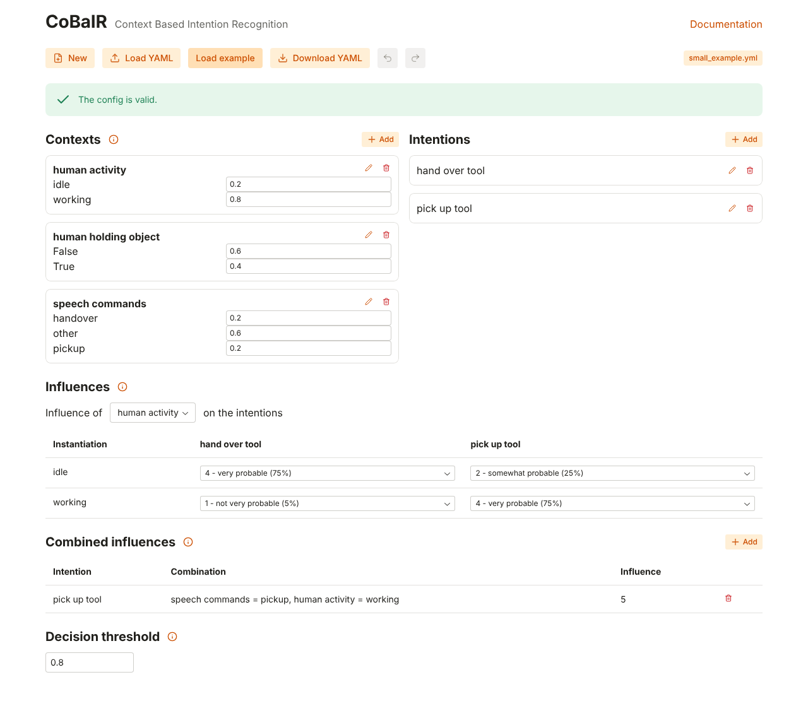

# Web GUI

The web GUI is the primary GUI of CoBaIR. Install and start it with

```bash
pip install "cobair[web]"
cobair-web
```

`cobair-web` serves the GUI on <http://localhost:8000> and opens it in your browser.
No Node.js is needed: the frontend is pre-built and part of the package.

| option | |
|---|---|
| `config.yml` | config file to open, **Save** writes back to it (created on save if it doesn't exist) |
| `--port 8000` | port to listen on |
| `--host 127.0.0.1` | host to listen on, use `0.0.0.0` to open the GUI to other machines |
| `--no-browser` | don't open the browser |



## Configs
- **New** starts an empty config, **Load YAML** opens a file (or drop it on the button), **Load example** loads the
  example of the [Tutorial](Tutorial.md#example-scenario).
- **Download YAML** saves the config as a file. **Save** is shown when `cobair-web` was started with a file and
  writes to that file.
- Without a file, every change is kept as a **draft in your browser** and restored the next time you open the
  GUI, nothing gets lost when you close the tab.
- With a file, the badge **unsaved changes** shows that the config differs from the file, and the browser asks
  before you leave the page. *Download YAML* doesn't change that file.
- **Undo** / **Redo** (<kbd>Ctrl</kbd>+<kbd>Z</kbd> / <kbd>Ctrl</kbd>+<kbd>Shift</kbd>+<kbd>Z</kbd> or
  <kbd>Ctrl</kbd>+<kbd>Y</kbd>) step through your changes. While you type in a field, the shortcuts undo the text.
- Click the heading of a section or a context to fold it.

The config is only sent to the `cobair-web` process that serves the page, nothing is stored on a server.

## Editing
The [Tutorial](Tutorial.md#configuring-a-cobair-scenario-with-the-gui) explains every setting; the
info icons in the GUI link there.

- **Contexts**: *Add* or the pencil icon open a dialog for the name, the instantiations and their apriori
  probabilities. Apriori probabilities can also be changed directly in the cards.
- **Intentions**: *Add*, rename (pencil icon) and delete (trash icon).
- **Influences**: choose a context, then choose a value for every instantiation and intention.
- **Graph**: click a context to unfold it and select it in the influence table, click an intention to highlight it.
- **Combined influences**: *Add* a value for a combination of instantiations, remove it with the trash icon.
- **Decision threshold**: a number between 0 and 1.

Problems of the config (e.g. apriori probabilities that don't sum up to 1) are listed at the top while you edit.

## For developers
The web GUI is a [Reflex](https://reflex.dev) app in `cobair/web` (Reflex is pinned to an exact version).

- Run it with hot reload: `cd cobair/web && reflex run`
- Build the frontend that is shipped in the package: `python -m cobair.web.build`
  (Reflex downloads the JavaScript tools it needs). In a source checkout (`pip install -e ".[web]"`)
  `cobair-web` does this by itself when the sources in `cobair/web` changed since the last build, e.g.
  after switching branches; otherwise the browser would keep reloading because the frontend doesn't
  match the backend state.
- Tests: `pytest tests/web`. The end-to-end tests start `cobair-web` and need the built frontend and
  Playwright (`pip install playwright && playwright install chromium`).
